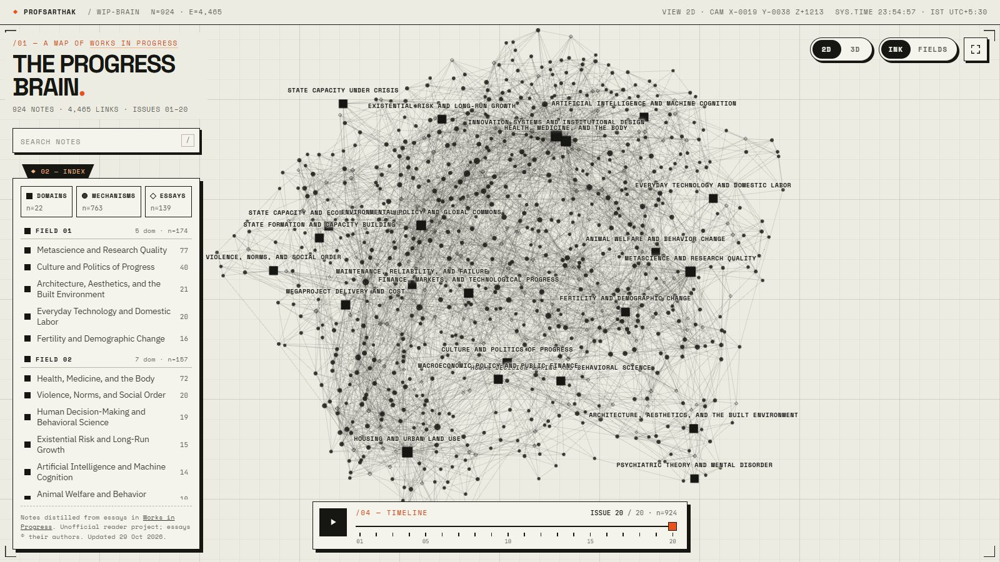

# Progress Through Works

An interactive 2D/3D map of my Obsidian second brain built from [Works in Progress](https://worksinprogress.co) magazine: every essay, the transferable mechanisms it argues for, and the fields those mechanisms belong to.

**Live: https://profsarthak.github.io/wip-brain/**



## What you're looking at

The vault has three layers, and the diagram keeps them as printed marks:

| Layer | Mark |
| --- | --- |
| **Domains** (`#domain`), the broad problem spaces | ■ labelled squares |
| **Mechanisms** (`#mechanism`), one reusable causal claim each | ● ink dots |
| **Essays** (`#source`), one per Works in Progress article | ◆ open diamonds |

Every `[[wikilink]]` in the vault is a pencil-weight line.

- **2D / 3D:** it opens as a flat diagram you can pan and zoom. Switch to 3D and it lifts into a brain you can spin.
- **INK / FIELDS:** ink keeps everything monochrome, with orange marking only what you've selected. Fields colours the 22 domains by six fields. The fields are found by modularity clustering on how densely the domains cross-link, which is the only use the brand allows its categorical palette.
- **Click any note:** see its core claim, a link to the original essay, and *Fig. 01*, a 2D local graph of its neighbours. Hovering a neighbour lights it up in the main diagram.
- **Timeline:** press play to watch the brain grow issue by issue.
- **Search:** press `/`. Domains in the index are clickable. Every note has a shareable link (`…/wip-brain/#Note Title`).

The look follows the [PROFSARTHAK design system](https://profsarthak.github.io/): bone paper and a hairline drafting grid, near-black ink, one hot-orange accent, square cards with hard offset shadows, folder tabs and crop marks, a `SYS.TIME` status bar, and Space Grotesk / Space Mono / IBM Plex Sans.

## Updating it

After new notes land in the vault, run:

```bash
python publish.py
```

The script reads the vault (it never writes to it) and rebuilds `docs/graph.json`. If anything changed, it commits and pushes, and GitHub Pages redeploys in a minute or two. If nothing changed, it does nothing.

| Option | |
| --- | --- |
| `--no-push` | rebuild only. Preview locally with `python -m http.server -d docs` and open http://localhost:8000 |
| `--vault PATH` | vault location (default: `~/Documents/Obsidian/Works in Progress`) |

To run it from a fresh machine: `gh repo clone profsarthak/wip-brain`, then `python publish.py`. It needs Python 3.8+ and nothing else.

## What gets published

Only note titles, links, issue numbers, domain membership, and the first paragraph of each note's *Core claim* (essays), *Definition* (mechanisms) or *Core problem* (domains). The full notes stay in the vault.

## How it's built

- `publish.py`: standard-library Python. It parses the vault's folders, tags, sections and wikilinks, and groups domains into fields.
- `docs/`: a static page with no build step. It uses [3d-force-graph](https://github.com/vasturiano/3d-force-graph) on three.js, with flat sprite marks, HTML labels for domains, and a hand-drawn SVG for the local graph. Brand tokens live at the top of `docs/style.css`.

Unofficial reader project. Essays © their authors.
